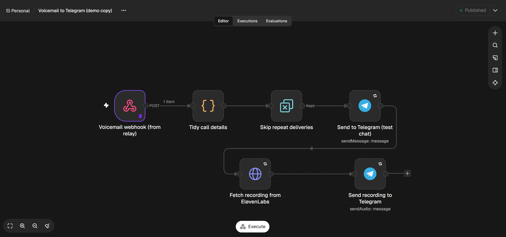
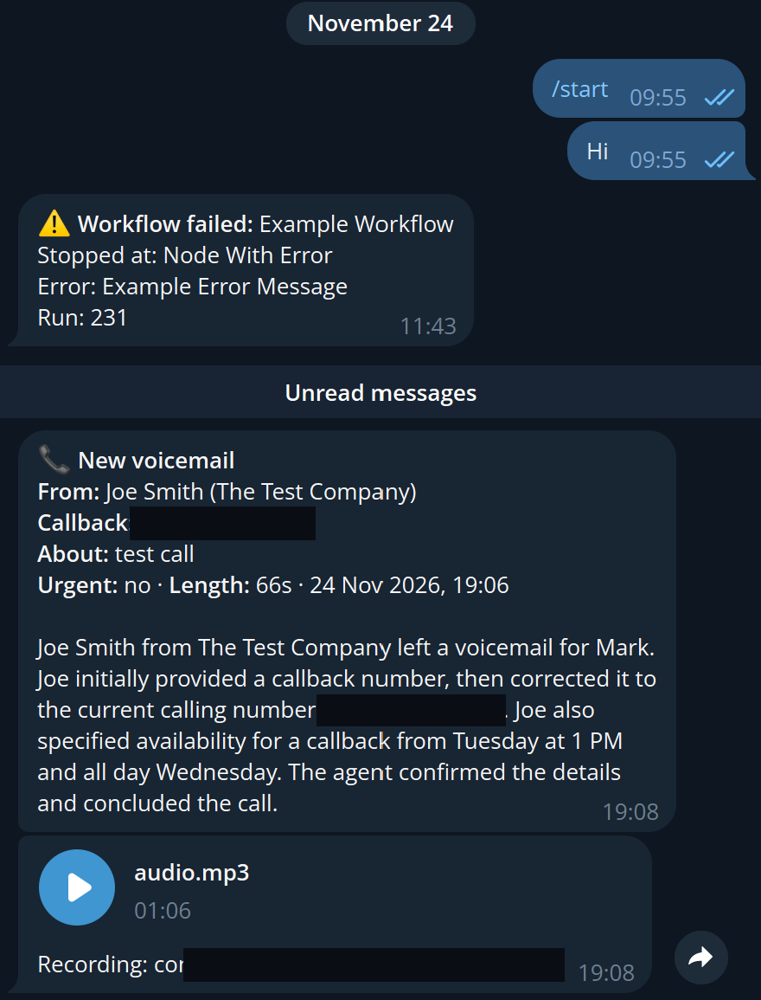
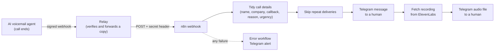

# Voicemail to Telegram: an n8n demo

A small n8n workflow that takes the "call finished" webhook from an AI voicemail agent and sends a clean, readable summary to Telegram. If anything fails, a second workflow raises an alert.

It is a demo copy of a pattern I run for my own phone line: an AI agent answers a missed call, takes a message, and the result lands on my phone. The same pattern suits any small business that misses calls. The agent itself is described in [`docs/voice-agent.md`](docs/voice-agent.md). This is not a client project, and I have not run n8n in production (see [Honest scope](#honest-scope)).

## For a quick review

- **What I built:** an n8n workflow that takes the "call finished" webhook from an AI voicemail agent and sends a Telegram summary and the recording to a person, plus a separate error workflow. It is my first n8n workflow, a personal demo and not a production system, built with AI assistance (see [Honest scope](#honest-scope)).
- **Tools and APIs:** n8n Cloud (Webhook, Code, Remove Duplicates, HTTP Request, Telegram and Error Trigger nodes), the ElevenLabs Conversational AI API (a read-only key fetches the recording), the Telegram Bot API, and a small relay in front that verifies each call event and forwards a copy.
- **Errors and retries:**
  - Requests without the secret header get a 403.
  - Repeat deliveries of the same call are skipped.
  - The Telegram sends and the recording fetch each retry 3 times, 3 seconds apart.
  - A separate error workflow sends a Telegram alert naming the workflow, the node and the error.
  - Successful runs are not stored, so caller details do not pile up in n8n. Failed runs are kept for debugging.
  - One known gap is described under [Honest scope](#honest-scope).
- **Walkthrough video:** a screen recording of a real test call, the Telegram summary and the mp3 is available on request.





## What it does



1. **Webhook** accepts only requests carrying the secret `Authorization` header. Anything else gets a 403.
2. **Tidy call details** (a short Code node) reads the agent's structured call data and builds the message. Missing fields show as "not given". Anything that is not an inbound transcription event is dropped quietly on this path, including the separate audio event and calls placed by my other (outbound) agent, which share the same webhook.
3. **Skip repeat deliveries** remembers each conversation id, so a replayed webhook does not send a second message.
4. **Telegram** sends the summary to a test chat. The send step retries up to 3 times.
5. **Fetch recording** asks the ElevenLabs API for the call's mp3 (the webhook does not carry the audio in my setup), using a read-only key held as an n8n credential. The step retries up to 3 times, because the file can take a moment to be ready. A retrying Telegram "send audio" step then sends it as its own message after the summary. If the fetch fails, the summary has already gone and the error workflow alerts.
6. **Error workflow** (separate file) sends a Telegram alert naming the workflow, the node it stopped at and the error.

Example output, from the synthetic sample in `sample-payloads/`:

```
📞 New voicemail
From: Alex Sample (Example Joinery)
Callback: 07700 900123
About: Quote request for a kitchen fit
Urgent: no · Length: 47s · 23 Nov 2026, 16:43

Alex Sample from Example Joinery asked for a quote on fitting a kitchen and wants a callback this week.
```

## Design choices

| Choice | Why |
|---|---|
| Runs as a **copy** alongside an existing flow | The live voicemail keeps working whatever this workflow does. Removing the copy loses nothing. |
| Secret header on the webhook (n8n credential, not in the file) | Only the trusted relay can post. The secret is never stored in this repo. |
| Inbound-only filter | Outbound calls share the same webhook and can contain other people's conversations. They never reach Telegram. |
| Successful runs are not saved in n8n | Execution history would otherwise keep caller names, numbers and transcripts. Failed runs are kept so they can be debugged. |
| Repeat-delivery check on the conversation id | Webhooks get replayed. One call should mean one message. |
| Text is escaped before it goes to Telegram | Callers can say anything. A stray `<` or `&` must not break the message or the alert. |
| Retry on the send, plus a separate error workflow | A failed alert should be visible, not silent. |
| Test chat only, synthetic sample data only | No real caller details in this repo, ever. |

## Running it alongside the live line

In my setup the voicemail agent posts a signed webhook to a small relay, which checks the signature, de-duplicates, and sends an email with the recording plus a Telegram summary. The relay can also forward a copy of the verified event to one extra URL, and that is how n8n receives real calls.

- The copy is sent **last**, after the email and Telegram have gone, and its result cannot change theirs. If n8n is down or slow, the existing alerts are unaffected.
- It is switched on by two settings on the relay (the n8n production URL and the secret). Removing both puts everything back exactly as it was. No code changes.
- n8n only ever sees events the relay has already verified, so the n8n side checks a shared secret rather than repeating the signature check.
- Real calls are never stored or shown in this repo. Only the made-up samples are.

## Human in the loop

Nothing in this workflow acts on a caller. It tells a person, and the person decides.

- A call where the caller left no callback number or hung up early is labelled "incomplete, worth a callback?". A human decides whether to follow it up.
- In the wider setup this demo comes from (not in this repo), outbound calls are never placed without a script rundown and an explicit green light from me.

Ideas I have not built: a Telegram message with Approve and Dismiss buttons for incomplete calls, using n8n's send-and-wait step, and a Google Sheet log of every call.

## Honest scope

- **n8n experience:** this is the first n8n workflow I have built. I have not run n8n in production. My background is Power Automate flows, webhooks, REST APIs, Python and Microsoft Graph, and the same patterns apply here.
- **Data:** the sample payloads are made up. They follow the shape of the post-call data my voicemail agent sends (the six fields in `docs/voice-agent.md`), with invented names and a number from the UK drama range.
- **Testing so far:** run locally on n8n 2.35.7 with `tests/run-local-test.sh`: wrong token rejected, a complete call formatted, a repeat call skipped, an incomplete call with `<` and `&` in it made safe, and an audio event and an outbound call ignored. That run was before the recording step was added. The script swaps the recording fetch for a no-op too, so it does not test it. The Telegram send and the error workflow are not tested by that script (the test swaps Telegram for a no-op).
- **On n8n Cloud (24 Nov):** ran end to end on n8n Cloud with real test calls to my own line using made-up details. The summary and the mp3 recording both reached Telegram. Telegram throttled the first bot overnight (HTTP 429), so I created a second bot and the throttling stopped. The error alert was also tested by deliberately failing a step.
- **Known trade-off:** the repeat check records a call before Telegram is attempted. If Telegram fails all three tries, the same call sent again would be skipped. The failure alert is there so that gets noticed and the call can be followed up by hand.

## How this was built

Built with AI assistance (Claude). The voicemail setup it copies, the shape of the data, the choice of what to show and what to protect, and what the workflow should refuse to do are mine. Claude drafted the workflow JSON and the test script, and I run and check them. I say so up front because it is how I work: I design and direct, AI helps write, and I test before I trust it.

## Quick start

1. Create a free test Telegram bot with BotFather and send it a message. Note the bot token and your chat id.
2. In n8n: **Workflows → Import from file**, and import both files from `workflows/`.
3. Create two credentials:
   - **Telegram API** with the test bot token.
   - **Header Auth** with name `Authorization` and value `Bearer ` followed by a long random string (a password manager can generate it).
4. Open each workflow and select the credentials. Replace `REPLACE_WITH_TEST_CHAT_ID` with your chat id in both Telegram nodes.
5. In the main workflow: **Settings → Error workflow**, and pick the error-alert workflow.
6. Publish the main workflow and copy its **Production URL**.
7. Send a sample:

```bash
curl -X POST "<your production url>" \
  -H "Content-Type: application/json" \
  -H "Authorization: Bearer <your random string>" \
  --data @sample-payloads/01-complete-voicemail.json
```

The test URL only listens while you click "Listen for test event". The production URL needs the workflow published.

## Files

| Path | What it is |
|---|---|
| `docs/voice-agent.md` | How the voicemail agent behaves and what data it produces |
| `docs/agent-prompt.md` | The agent's full instruction prompt, shared as it stands (owner's name removed) |
| `workflows/voicemail-to-telegram.json` | The main workflow |
| `workflows/error-alert.json` | Error workflow: Telegram alert on any failure |
| `sample-payloads/` | Made-up call data: a complete call, an incomplete call, and an audio event and an outbound call that are both ignored |
| `LICENSE` | MIT licence |
| `tests/run-local-test.sh` | Local test run on a throwaway n8n install, no accounts needed |

## Not in this repo

Real call data, caller details, recordings, tokens, webhook secrets, chat ids, phone numbers, or anything from an employer or client.

## Licence

MIT. See [`LICENSE`](LICENSE).
